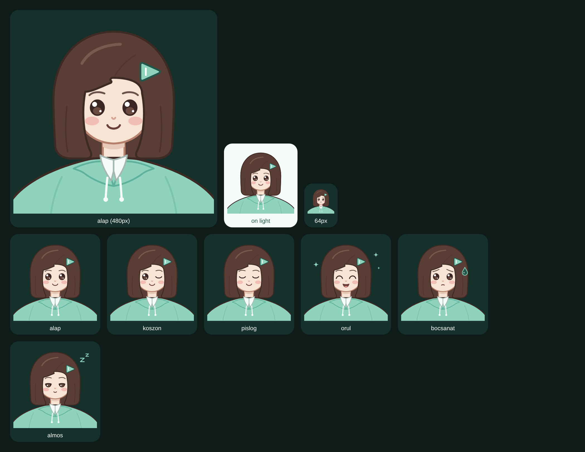

# Dalma

Androidos app, amely egy YouTube-videóból **egyetlen koppintással** minőségi zenét ment.
A YouTube-ban megnyomod a Megosztást, kiválasztod Dalmát, és egy kis lapon ő azonnal munkához lát:
elfordul, a hajcsatja megtelik, aztán örül, és egy rövid mondattal jelzi, hogy kész.
Nincs beállítás, nincs gomb, nincs lista. A formátumot, a minőséget és a hibákat az app intézi.

<p align="center"></p>

## Mit tud

- **Opus, ahogy a YouTube adja** (251-es folyam, kb. 160 kbit/s), átkódolás nélkül; ha egy dalhoz nincs
  Opus, AAC (`.m4a`). Előadó, cím, album, év és **négyzetes borító** a fájlba írva, hogy a gyári lejátszó
  rendesen mutassa.
- **A Zene mappába ment** (`Előadó – Cím.opus`), tárhely-engedély nélkül, és soha nem ír felül semmit.
- **Érti a linkeket**: Shorts, youtu.be, YouTube Music, mobillinkek, megosztott szöveg közepén is.
  Listából megosztott dalnál csak azt az egyet menti, listalinknél az egész listát (legfeljebb 300-at).
- **Már megvan**: ugyanazt a dalt nem tölti le kétszer, csak annyit mond: *Ez már megvan.*
- **Háttérben is befejezi**, ha lehúzod a lapot vagy kilépsz; értesítésben megszakítható. Ha nincs net,
  sorba teszi, és magától elindul, amint lesz. Megszakadt letöltést folytat.
- **Megjavítja magát**: a yt-dlp letöltőmotor naponta frissül, hiba után frissítve, más YouTube-kliensekkel,
  más formátummal, egyszerűbb feldolgozással próbál újra, és csak a végén kér bocsánatot egy mondattal.
- **Helyellenőrzés** letöltés előtt; érthető mondatok hiba esetén (*Nincs net. Amint lesz, elmentem.*,
  *Ezt nem érem el, mert privát.*).
- **Engedélyek**: csak internet és értesítés.

## Dalma

Mindig sötét, menta és tejfehér egy mély éjszakai zöldön, csillagos ég, Fraunces és Nunito betűk.
Dalma lélegzik, pislog, néha körbenéz, köszönéskor biccent és kacsint, este álmos. Töltés közben
közelebb jön, elfordul, és a lejátszás-jel alakú hajcsatja a valódi százalékkal telik; a végén
halkan rezeg a telefon, és egy hullócsillag fut át az égen. Ha a telefonon ki van kapcsolva az
animáció, Dalma állóképekkel jelez.

A mostani Dalma vektoros rajz (`docs/mascot/dalma.svg`). Ha elkészülnek az AI-val rajzolt képek és
klipek (lásd a feladatleírást a `docs/spec/` mappában), a `tools/dalma-assets.py` kivágja a magenta
hátteret, átlátszó PNG-t és animált WebP-t készít az `app/src/main/assets/dalma/` mappába, és az app
onnantól azokat használja. Hosszan nyomva a főképernyőt előjön a rejtett névjegy: verzió, motor, licencek.

## Telepítés

1. A [Releases](https://github.com/iTemujinWork/YT-convert-APK/releases) oldalról töltsd le a
   `Dalma-x.y.z.apk` fájlt (vagy az **előnézeti** kiadást, amely minden commitból készül).
2. Engedélyezd az ismeretlen forrásból telepítést, és telepítsd. Android 10 vagy újabb kell.
3. A YouTube-ban: Megosztás → Dalma. Az első alkalommal a rendszer egyszer megkérdezi, küldhet-e
   értesítést; ez kell ahhoz, hogy a háttérben is menthessen.

Az app naponta egyszer megnézi, van-e újabb kiadás, és egy sorral szól: *Van újabb Dalma.*

## Fejlesztés

- `core/`: tiszta Kotlin, Android SDK nélkül fordul és tesztelhető: `./gradlew -p core test`.
  A valódi yt-dlp + ffmpeg futtatásával: `./gradlew -p core test -Ddalma.engineTests=true -Ddalma.ytdlp=$(which yt-dlp)`.
- `app/`: Jetpack Compose, WorkManager, MediaStore; a letöltőmotor a
  [youtubedl-android](https://github.com/yausername/youtubedl-android) csomagolta Python + yt-dlp +
  QuickJS + FFmpeg. Teljes build: `./gradlew :app:assembleRelease` (Android SDK kell).
- Tesztek: Robolectric + Roborazzi képernyőképek (`./gradlew :app:recordRoborazziDebug`), emulátoron a
  motor és a Zene mappa (`./gradlew :app:connectedDebugAndroidTest`).
- CI: a `.github/workflows/build.yml` minden pushra lefuttatja a teszteket, a lintet, elkészíti a
  képernyőképeket (a `ci-screenshots` ágra tolja), és feltölti az arm64 APK-t előnézeti kiadásként;
  `v*` tagnél aláírt kiadás készül.

### Aláírás

A kulcs nálad marad. Egyszer, a gépeden:

```bash
keytool -genkeypair -v -keystore dalma.jks -alias dalma -keyalg RSA -keysize 4096 -validity 36500
```

Készíts róla biztonsági másolatot (elveszett kulccsal a barátok csak újratelepítéssel tudnak frissíteni),
majd add meg a repó *Settings → Secrets and variables → Actions* oldalán:

| Titok | Érték |
| --- | --- |
| `DALMA_KEYSTORE_BASE64` | `base64 -w0 dalma.jks` kimenete |
| `DALMA_KEYSTORE_PASSWORD` | a keystore jelszava |
| `DALMA_KEY_ALIAS` | `dalma` |
| `DALMA_KEY_PASSWORD` | a kulcs jelszava |
| `DALMA_UPDATE_READ_TOKEN` | csak privát repónál: csak-olvasó token a frissítés-ellenőrzéshez |

Titkok nélkül a CI debug-kulccsal ír alá; ilyen APK-ról később a saját kulcsos verzióra csak
törlés után lehet váltani.

## Licencek

yt-dlp (Unlicense), youtubedl-android (GPL-3.0), FFmpeg (LGPL/GPL), Python (PSF), QuickJS (MIT),
Fraunces és Nunito (OFL 1.1), Jetpack Compose és AndroidX (Apache 2.0). A youtubedl-android GPL-3.0
licence miatt aki megkapja az appot, kérésre a forrását is megkaphatja: ez a tároló az.
